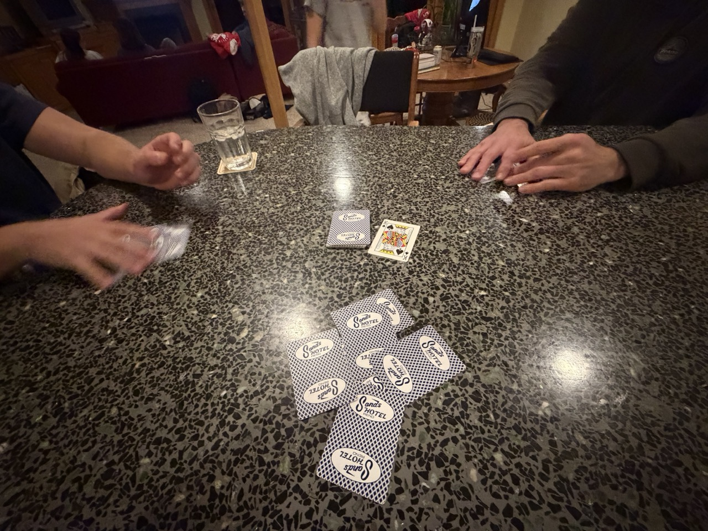
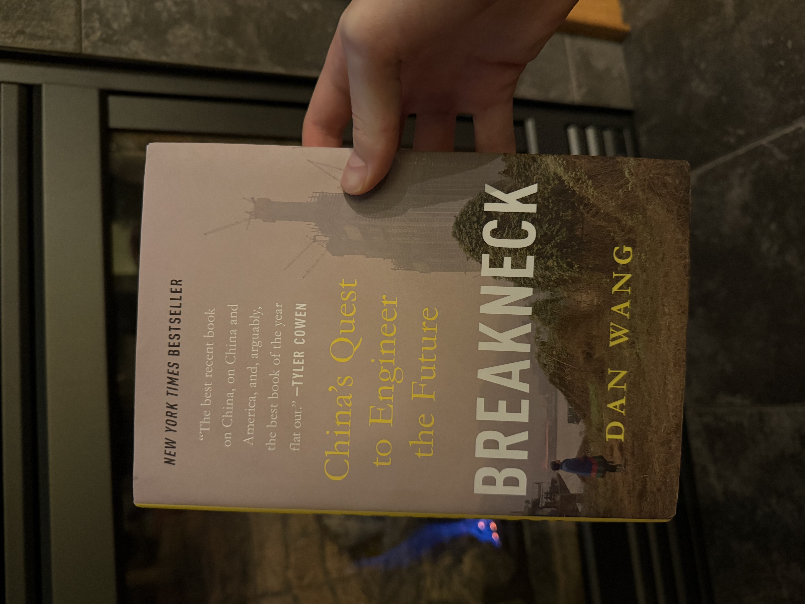
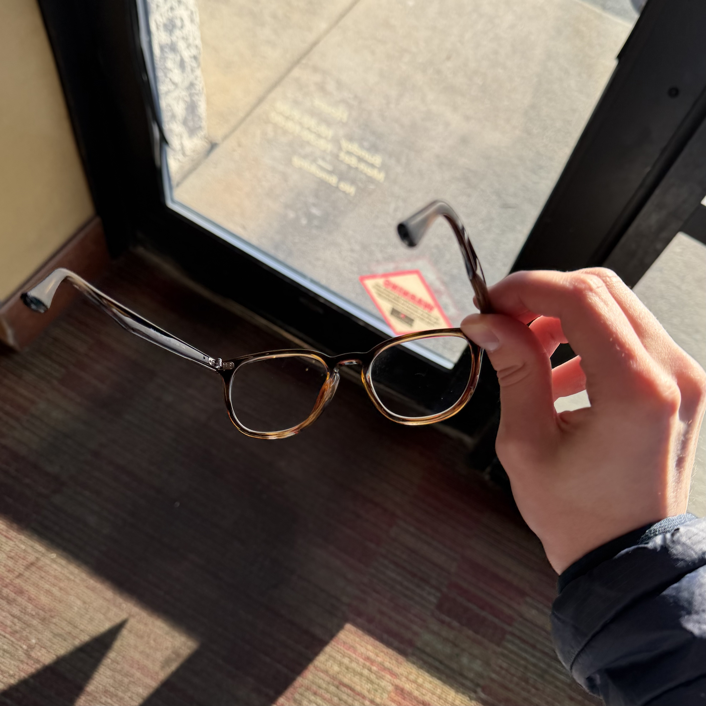
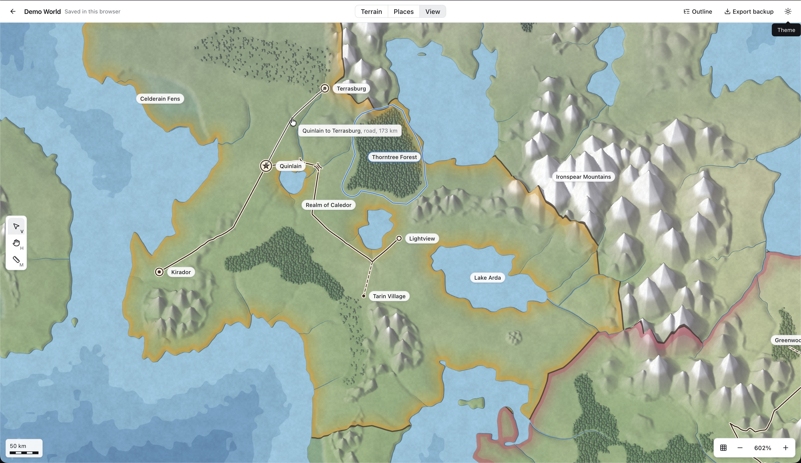
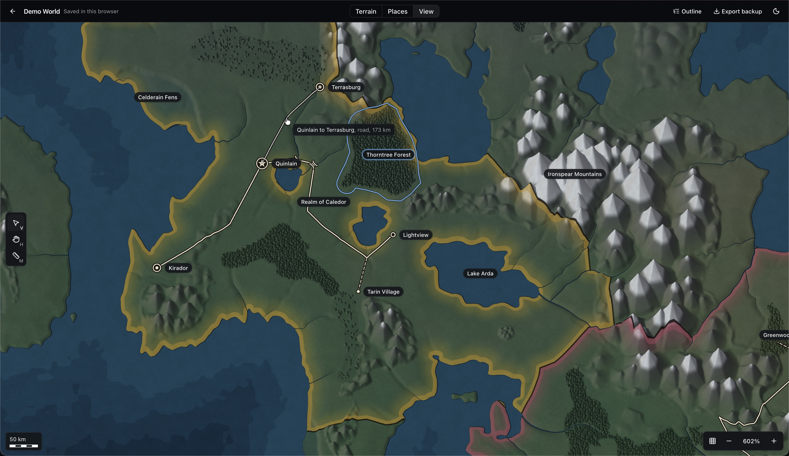

Happy Thanksgiving from Wisconsin! I'm back home, and enjoying time with my family, warm and lead-free (seriously, what the heck?!)

<figure style="max-width: 75%">
    
    <figcaption>A hand of <a href="http://www.gamecabinet.com/rules/Durak.html" target="_blank">Durak</a>, my favorite card game</figcaption>
</figure>

I don't know whether you (my wonderful, ephemeral reader) feel this way, but to me, Thanksgiving is an opportunity to reflect on all the people, experiences, and circumstances that have shaped me into who I am today, and to be thankful for them—not because everything went right, but because everything *went*, and in the end produced precisely me.

I know I always leave feeling just a little bit more centered, and just a little bit more sure.

I completed *Breakneck* in my quest to learn a little more about China (and to argue a little bit more effectively with <a href="https://nlessard.online/" target="_blank">Noah</a>, tehe). The book delivered in spades, communicating, among other things, that China is remarkably capable of building toward ambitious national goals, but often at the expense of individual liberty, while the United States seems increasingly unable to get out of its own way (<a href="https://app.thestorygraph.com/reviews/7ed68e35-2102-4ced-a434-49ddf8560b0b" target="_blank">my review</a>).

<figure style="max-width: 60%">
    
    <figcaption>Breakneck, by Dan Wang (2025)</figcaption>
</figure>

I also purchased *Inventing the Renaissance* by Ada Palmer at a <a href="https://lakecitybooks.com/" target="_blank">local Madison book store</a>, a hefty seven-hundred-page tome with a fresh and energetic voice. I've read a few pages, and I'm already hooked.

In other news, I picked up glasses earlier this week after receiving a mild prescription for nearsightedness. I realized I needed glasses when I tried on <a href="https://www.amoses.dev/" target="_blank">Andrew's</a> pair. The world is a whole lot sharper now at a distance.

<figure style="max-width: 60%">
    
    <figcaption>New glasses!</figcaption>
</figure>

I've been burning the midnight Fable making a mapping software tool over the past few days. I'm a big cartographer, mostly mapping on paper and in Photoshop. This new tool shakes things up a bit! The landscape and rainfall engine is inspired by <a href="https://www.redblobgames.com/" target="_blank">Red Blob Games'</a> <a href="https://www.redblobgames.com/maps/mapgen4/" target="_blank">mapgen4</a>, with additional mechanics for managing a "human layer" on top of the geography---realms, regions, settlements, roads, etc., with a lot more in the works.

<figure style="max-width: 90%">
    
    
    <figcaption>Mapping software I'm working on (very WIP)</figcaption>
</figure>

My favorite part is that the map figures out a lot on its own. For example, you never draw a river; you just paint mountains, and the engine decides how rainfall accumulates and where the water runs. Similarly, a road sketched between two towns avoids rough terrain and automatically bridges any rivers it crosses. I'll have more to show soon!
