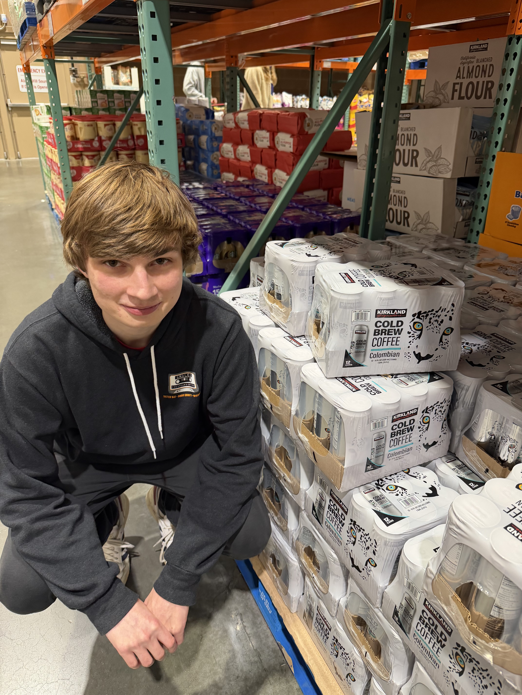
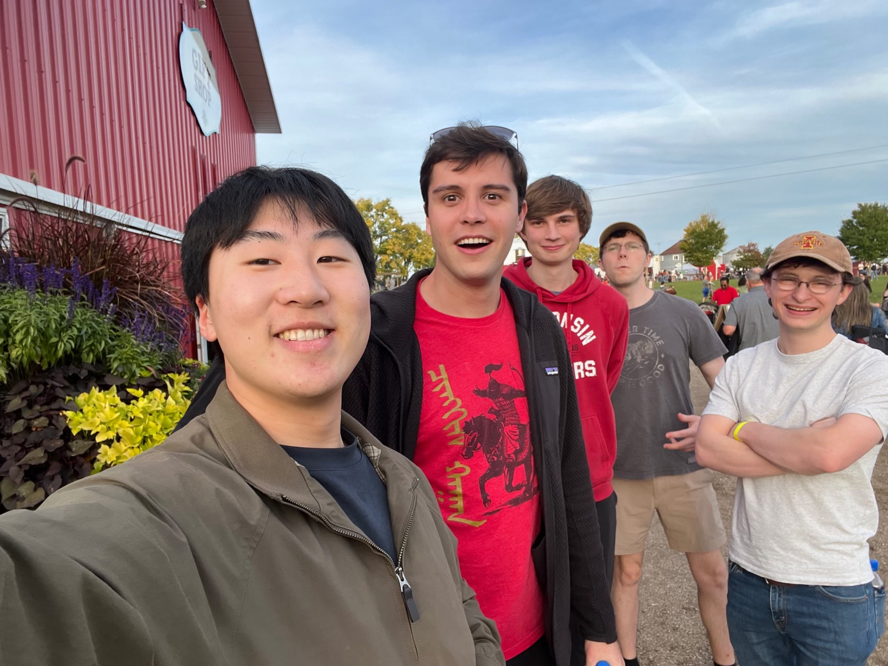
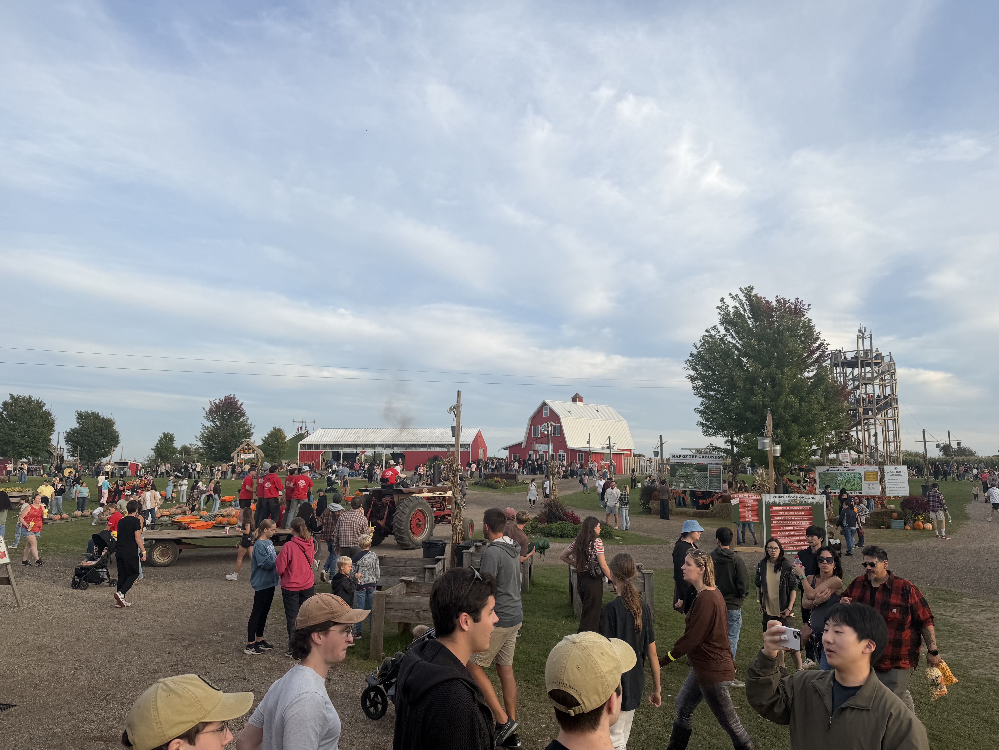
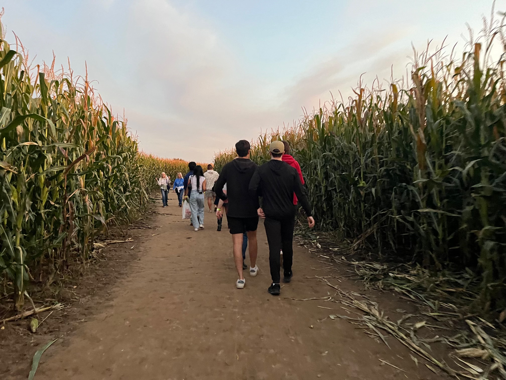
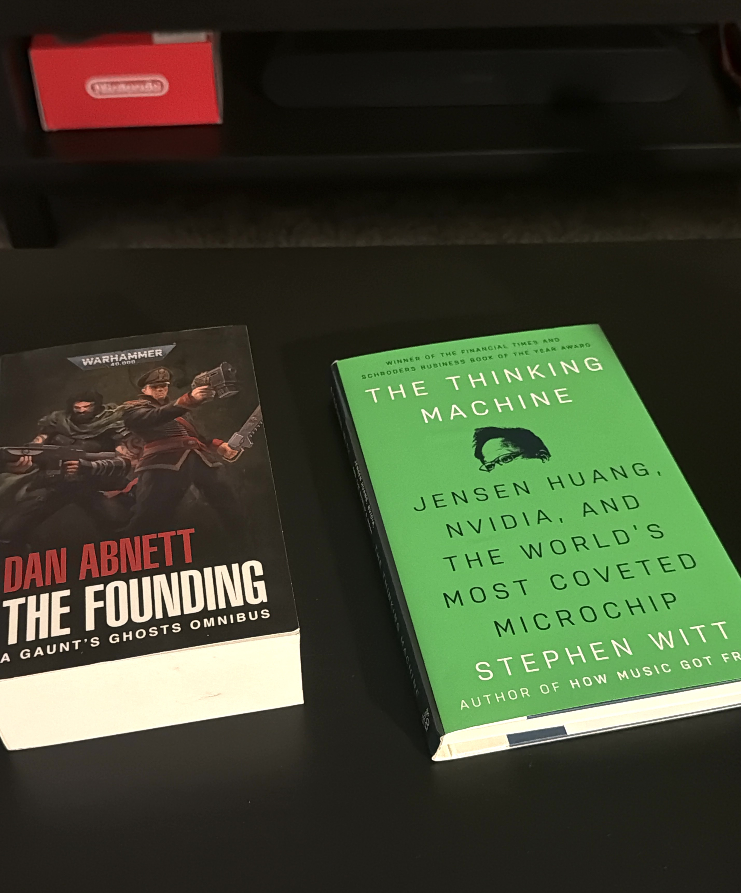
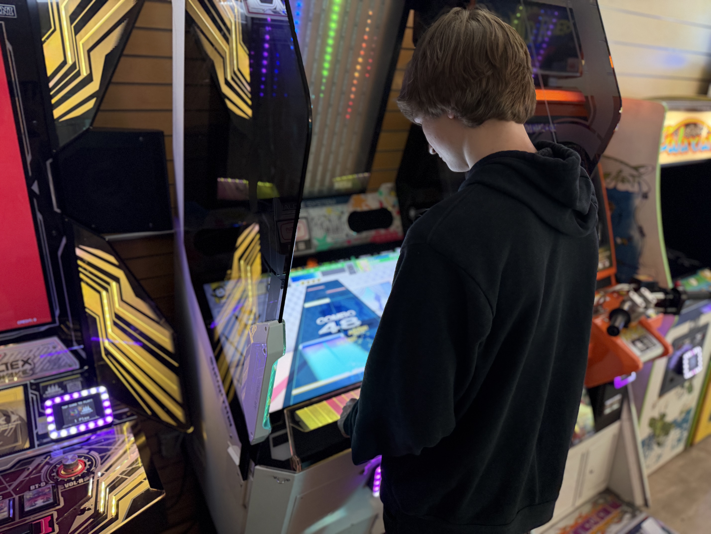

Welcome back to the life of Nico! The trees have lost nearly all of their leaves and it is getting much colder, but that's okay. 
<figure>

<figcaption>And so he plays his part</figcaption>
</figure>

Earlier this month, I went to a big "farm" in Illinois. It was commercialized to all hell with a ton of attractions, including a pig racing ring, bouncy castles, a zipline, beer gardens, hot cider, and a massive corn maze (with a bridge):

<figure>

<figcaption>We few, in a sea of humanity</figcaption>
</figure>

There were *thousands* of people there, and with how many cars were packed into the grassy parking lot, it reminded me of long term airport parking. 
<figure>

<figcaption>The farm promenade</figcaption>
</figure>

We were in the maze when the sun went down. Wandering through the corn in the dark was pretty fun.

<figure>

<figcaption>Marching into the corn maze</figcaption>
</figure>

More recently, I finished *The Thinking Machine*. It's a story about Jensen Huang and the rise of NVIDIA. It was almost a bit doomery at times, with the author making Huang out to be an Icarus-like figure leading a reckless charge towards progress with little regard for ramifications.

<figure style="max-width: 60%">

<figcaption>The Thinking Machine, by Steven Witt (2025)</figcaption>
</figure>

<a href="https://www.amoses.dev/" target=_blank>Andrew</a> introduced me to Chunithm (or Chuni). It's a neat rhythm game developed by Sega. He managed to find a rig in a nearby mall arcade, and we've visited it a few times. The mascot is a cute penguin!

<figure style="max-width: 75%">

<figcaption>Chuni kind of feels like playing piano, sort of.</figcaption>
</figure>